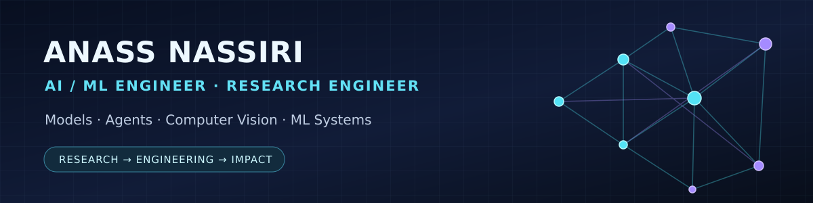

 

### Research-minded engineering. Production-minded research.

**AI/ML Engineer &nbsp;·&nbsp; Research Engineer &nbsp;·&nbsp; MSc in Artificial Intelligence**

📍 Milan, Italy &nbsp;|&nbsp; Open to AI Engineer, ML Engineer and Research Engineer roles

---

### `01 // THE ENGINEER BEHIND THE MODELS`

I'm **Anass Nassiri**, an AI/ML engineer with a joint **MSc in Artificial Intelligence for Science and Technology** from the universities of Milano-Bicocca, Milan and Pavia. I work across **deep learning, computer vision, vision-language models, LLMs, AI agents and cloud ML systems**.

My approach: **build clean datasets → run reproducible experiments → evaluate what matters → engineer robust systems**.

<table>
<tr>
<td width="33%" align="center"><strong>73,374</strong> Images in validated garment dataset</td>
<td width="33%" align="center"><strong>NVIDIA A100</strong> Cloud training and model benchmarking</td>
<td width="33%" align="center"><strong>LLMs + CV</strong> Research experiments and software delivery</td>
</tr>
</table>

### `02 // SELECTED WORK`

<table>
<tr>
<td width="50%" valign="top">
<strong>⚙️ <a href="https://github.com/ANASS19/forgeflow">ForgeFlow</a></strong> 
Developer tooling · Workflow orchestration  
Experimental local-first Python workflow engine with validated DAGs, async execution, HTTP steps, bounded retries, SQLite run evidence, and automated CI.  
<code>Python</code> <code>AsyncIO</code> <code>Pydantic</code> <code>SQLite</code> <code>CI</code>
</td>
<td width="50%" valign="top">
<strong>🎙️ <a href="https://github.com/ANASS19/Voice-Agents">Voice AI Agents</a></strong> 
Agentic AI · Tool orchestration  
FastAPI voice-agent prototype with LLM tool calling, browser speech, lead-capture workflows and optional phone integration.  
<code>FastAPI</code> <code>LLMs</code> <code>Tools</code> <code>Twilio</code>
</td>
</tr>
<tr>
<td width="50%" valign="top">
<strong>🧠 <a href="https://github.com/ANASS19/LLM-with-RAG-and-OLLAMA">RAG & Local LLM Assistant</a></strong> 
Retrieval · Full-stack AI  
Flask/React chatbot integrating Ollama, vector retrieval, LangChain and ChromaDB with modular embedding and retrieval components.  
<code>Ollama</code> <code>RAG</code> <code>ChromaDB</code> <code>React</code>
</td>
<td width="50%" valign="top">
<strong>👁️ <a href="https://github.com/ANASS19/Incremental-Face-Recognition-System">Incremental Face Recognition</a></strong> 
Computer vision · Identity recognition research  
A computer-vision project exploring incremental face-recognition workflows for authorized access use cases.  
<code>Computer Vision</code> <code>Deep Learning</code> <code>Python</code>
</td>
</tr>
</table>

### `03 // AI RESEARCH & INDUSTRY EXPERIENCE`

**Rendi · AI & Computer Vision Engineer Intern (2026)**

- Engineered a reproducible **73,374-image** garment dataset using fixed splits, **38 WebDataset shards**, and exact-hash leakage validation.
- Trained and evaluated **ConvNeXt, DINO-family and SigLIP2-based** computer-vision models with **PyTorch on NVIDIA A100 GPUs**, comparing task-specific metrics, errors and runtime behavior.
- Used **Modal + AWS S3 + Weights & Biases** for repeatable experiments and traceable outputs. Investigated weighted ensembles, calibration and multimodal inference workflows.

**BitApp · AI Engineer, LLM/RAG & Agent Workflows (2025)**

- Built document-grounded assistants with **FastAPI, LangChain, LangGraph, ChromaDB, Ollama and MCP integrations**.
- Implemented tool-using agent flows, routing, structured-output validation, fallback logic and multi-turn evaluations.

**Research thesis · Automated Garment Assessment in E-commerce**

- Original MSc research on **Computer Vision, Deep Learning and Vision-Language Approaches** for garment assessment, model benchmarking and reliability.
- Also explored **calibrated, grid-based garment measurement** as an evolving R&D direction.

### `04 // ENGINEERING STACK`

**AI & Modeling**

**LLM Systems & Cloud Engineering**

**Deep learning:** PyTorch · Hugging Face Transformers · CNNs · vision-language models · transfer learning · LoRA · benchmarking

**LLM systems:** RAG · LangChain · LangGraph · Ollama · MCP · ReAct · tool calling · structured outputs

**MLOps & engineering:** FastAPI · Pydantic · Modal · AWS S3 · Weights & Biases · Docker · GitHub Actions · SQL · evaluation & tests

### `05 // EDUCATION`

**MSc, Artificial Intelligence for Science and Technology (2026)**  
*Joint programme: University of Milano-Bicocca, University of Milan and University of Pavia, Italy*

**Professional Bachelor's, Computer Systems and Software Engineering (2022)**  
*Cadi Ayyad University, Morocco*

**University Diploma of Technology, Business Intelligence and Data Sciences (2021)**  
*Cadi Ayyad University, Morocco*

---

### Let's build useful, reliable AI.

<a href="https://github.com/ANASS19/cv-portfolio/blob/master/CV.md"><strong>📄 Curriculum Vitae</strong></a> &nbsp;·&nbsp; <a href="https://www.linkedin.com/in/anass-nassiri-5487051a3/"><strong>LinkedIn</strong></a> &nbsp;·&nbsp; <a href="mailto:nassirri115@gmail.com"><strong>Get in touch</strong></a>

Open to AI/ML engineering and research engineering opportunities · Milan, Italy

