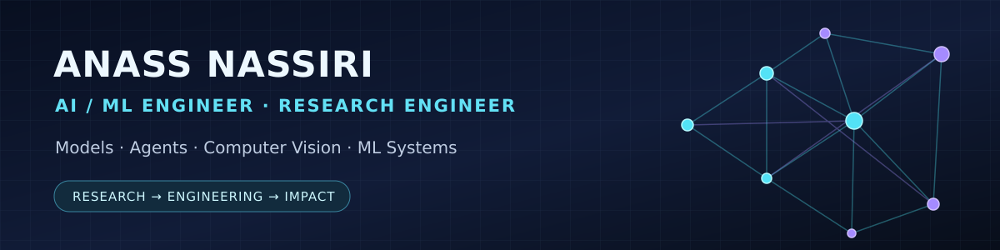

### Building AI systems from research to reliable engineering

[**📄 View CV**](./CV.md) &nbsp;·&nbsp; [**💼 LinkedIn**](https://www.linkedin.com/in/anass-nassiri-5487051a3/) &nbsp;·&nbsp; [**🔬 GitHub Projects**](https://github.com/ANASS19?tab=repositories)

---

📍 Milan, Italy · [LinkedIn](https://www.linkedin.com/in/anass-nassiri-5487051a3/) · [GitHub](https://github.com/ANASS19) · [Website](https://a-nassiri.me) · [Email](mailto:nassirri115@gmail.com)

## Curriculum Vitae

**[Read my full AI/ML Engineering & Research CV](./CV.md)**

A general-purpose résumé for **AI Engineer**, **Machine Learning Engineer**, **Research Engineer**, **Applied AI**, **Computer Vision**, **LLM/Agent Engineering**, and **ML Systems** roles.

## About

MSc graduate in **Artificial Intelligence for Science and Technology**, with practical experience across deep learning, computer vision, multimodal AI, retrieval-augmented generation, tool-using agents and cloud experimentation.

At Rendi, I helped build and validate a **73,374-image ML dataset** and benchmarked deep-learning models on NVIDIA A100 GPUs with reproducible experiments, evaluation reports and failure analysis. At BitApp, I worked on document-grounded LLM applications and agentic workflows. I also build independent, public engineering projects.

## Areas of expertise

| AI research & model development | AI engineering & ML systems |
| --- | --- |
| PyTorch, Transformers, CNNs, vision-language models | FastAPI, Pydantic, Python, Docker, Linux |
| Experimental design, training, benchmarking, calibration | Modal, AWS S3, W&B, GitHub Actions, testing |
| Computer vision, multimodal AI, reproducible datasets | RAG, ChromaDB, LangGraph, tools and MCP |

## Selected public projects

- **[ForgeFlow](https://github.com/ANASS19/forgeflow)** — Experimental local-first workflow engine with typed validation, asynchronous DAG execution, HTTP steps, failure handling, SQLite run history and CI.
- **[Voice Agents](https://github.com/ANASS19/Voice-Agents)** — Tool-using conversational and voice agent prototype with FastAPI, CRM operations, browser speech and optional phone integration.
- **[LLM with RAG and Ollama](https://github.com/ANASS19/LLM-with-RAG-and-OLLAMA)** — Full-stack Flask/React retrieval-augmented chatbot using LangChain, ChromaDB and Ollama.
- **[Incremental Face Recognition](https://github.com/ANASS19/Incremental-Face-Recognition-System)** — Computer-vision project repository.

## Education

**MSc, Artificial Intelligence for Science and Technology (2026)**  
Joint programme: University of Milano-Bicocca, University of Milan and University of Pavia.

**Professional Bachelor's in Computer Systems and Software Engineering (2022)**  
Cadi Ayyad University, Morocco.

**University Diploma of Technology in Business Intelligence and Data Sciences (2021)**  
Cadi Ayyad University, Morocco.

---

*Open to AI/ML engineering and research-engineering opportunities. This public portfolio intentionally excludes my telephone number and home address.*
